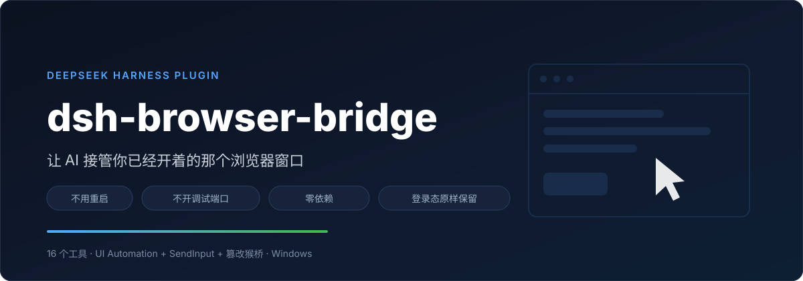
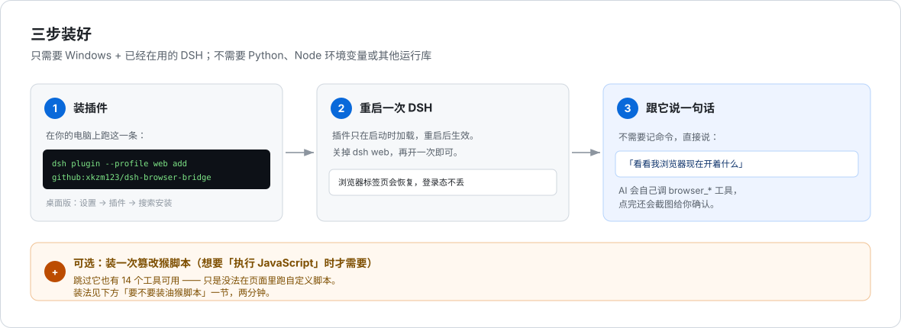
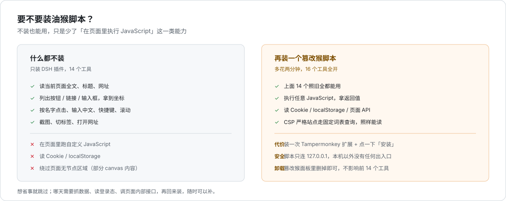
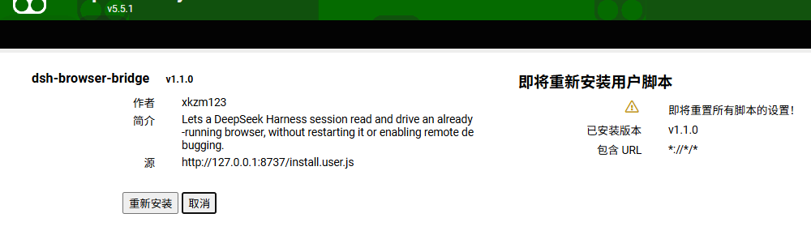
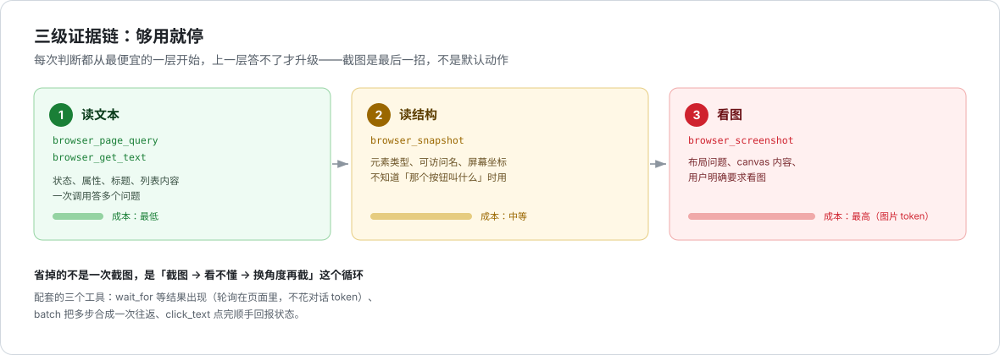
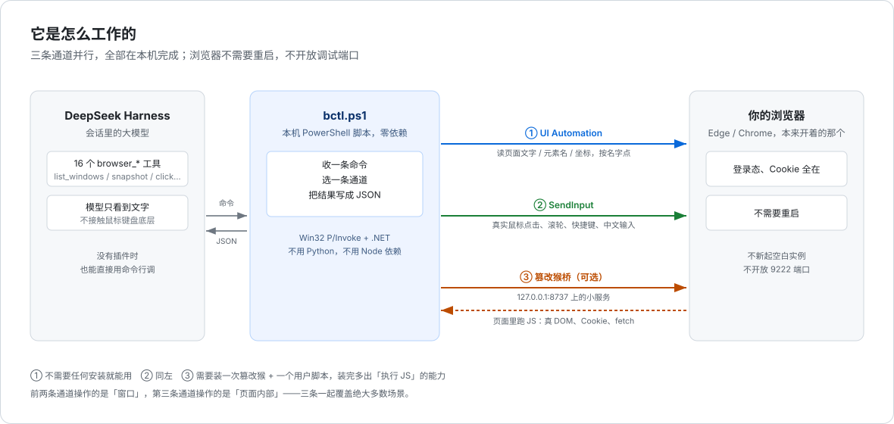

<p align="center">
  
</p>

<p align="center">
  <a href="https://github.com/xkzm123/dsh-browser-bridge/releases"></a>
  <a href="LICENSE"></a>
  
  
  
</p>

**一句话**：装好之后，你可以在 DeepSeek Harness 里说「帮我点那个按钮」，它就去点屏幕上**真的那个浏览器**——不是另开一个空白浏览器，就是你正在用的那个。

不用重启浏览器，不用装 Python 或 Node 环境，不用记命令。

---

## 目录

- [它到底能干什么](#它到底能干什么)
- [三步装好](#三步装好)
- [要不要装油猴脚本](#要不要装油猴脚本)
- [油猴脚本怎么装](#油猴脚本怎么装)
- [它怎么省钱](#它怎么省钱)
- [它是怎么做到的](#它是怎么做到的)
- [20 个工具](#20-个工具)
- [常见问题](#常见问题)
- [卸载](#卸载)

---

## 它到底能干什么

以前的 AI 只能告诉你「你应该点这里」。现在它能自己点。

| 你说的话 | 它做的事 |
|---|---|
| 「看看我浏览器现在开着什么」 | 读出所有浏览器窗口和标签页 |
| 「把这个页面的正文念给我听」 | 抽取整页可见文字 |
| 「把那个登录按钮点了」 | 找到叫「登录」的按钮，把鼠标移过去真点一下 |
| 「搜索框里填上显卡价格，回车」 | 点进输入框，输入中文，按回车 |
| 「B 站搜一下 xxx，给第一条点赞」 | 搜索 → 按标题挑结果 → 点赞 → 回报状态 |
| 「把页面上所有链接收集起来」 | 返回全部链接地址 |

它操作的是**你已经登录的浏览器**。所以需要登录才能看到的页面、买了会员才能看的内容，它都看得到——你不用把账号密码交给任何人。

---

## 三步装好

<p align="center">
  
</p>

### 第一步：装插件

打开一个终端（开始菜单搜「PowerShell」也行），粘这一条回车：

```powershell
dsh plugin --profile web add github:xkzm123/dsh-browser-bridge
```

> **`web` 是什么？** 你的 DSH 运行配置的名字。多数人就是 `web`，照抄即可。
> 不知道的话，看一眼 `C:\Users\你\.dsh\profiles\` 下面有哪个文件夹，把它填进去。

**用桌面版 DSH 的看这里**：直接打开 **设置 → 插件**，搜 `dsh-browser-bridge` 装上就行，不用命令行。

装完会显示类似这样：

```
+ dsh-browser-bridge 1.3.0
Done in 5.1s
```

### 第二步：重启一次 DSH

插件只在 DSH 启动的时候加载，所以装完要重启一次。

- `dsh web` 用户：关掉终端里的进程，再 `dsh web` 开一次
- 桌面版用户：退出应用再打开

**浏览器不用重启**，标签页和登录状态都还在。

### 第三步：跟它说一句话

回到对话里，直接说：

> 看看我浏览器现在开着什么

它会调用 `browser_windows`，把窗口列表念给你听，比如：

```
* pid=14664 msedge 1920x1040 (frontmost) · 哔哩哔哩 — Microsoft Edge
  pid=22180 chrome  1440x900   · 工作台
```

`*` 是当前目标窗口。看到这种输出，就说明装好了。

### 怎么确认装得对不对

```powershell
dsh --profile web --dump-config | Select-String -Context 0,3 browser-bridge
```

能看到 `- id: dsh-browser-bridge` 这几行就是对的。

---

## 要不要装油猴脚本

**答案：不装能用，装了更强。先看这张对比图。**

<p align="center">
  
</p>

- **只装插件** → 14 个工具。读页面、点按钮、打字、滚动、截图、切标签，够日常用。
- **再装油猴脚本** → 20 个工具。多出来的都是**又快又省**的那一类：按文字点击、批量执行、等待元素、读页面状态。

**油猴（Tampermonkey）是什么**：一个浏览器扩展，专门用来跑「用户脚本」——一小段注入到网页里运行的代码。我们要装的那个脚本，负责把 AI 的指令送进页面内部执行。

依赖它的 6 个工具：

| 工具 | 作用 |
|---|---|
| `browser_click_text` | 按文字点击，点完直接回报状态 |
| `browser_page_query` | 用固定词表查询页面 |
| `browser_wait_for` | 等元素/文字出现，替代反复截图 |
| `browser_batch` | 一串动作一次调用 |
| `browser_run_js` | 跑任意 JavaScript |
| `browser_bridge` | 启动本地桥 |

---

## 油猴脚本怎么装

脚本就在本仓库里：**[`bridge/bridge.user.js`](bridge/bridge.user.js)**。任何一台电脑都能装，不依赖你本机有没有跑什么服务。

### 1. 装 Tampermonkey 扩展（装过的跳过）

- Edge：[microsoftedge.microsoft.com/addons](https://microsoftedge.microsoft.com/addons/detail/tampermonkey/iikmkjmpaadaobahmlepeloendndfphd)
- Chrome：[chromewebstore.google.com](https://chromewebstore.google.com/detail/tampermonkey/dhdgffkkebhmkfjojejmpbldmpobfkfo)

装不上（国内网络常见）就从 [tampermonkey.net](https://www.tampermonkey.net/) 下载 crx 手动拖进扩展页。

### 2. 装用户脚本

**方式 A：点这一行链接（推荐）**

```
https://raw.githubusercontent.com/xkzm123/dsh-browser-bridge/main/bridge/bridge.user.js
```

把上面这串地址粘进浏览器地址栏回车。Tampermonkey 认 `.user.js` 结尾，会自动弹出安装页：

<p align="center">
  
</p>

图上扫一眼这四处：

| 位置 | 内容 | 含义 |
|---|---|---|
| 左上 | `dsh-browser-bridge v1.3.0` | 脚本名和版本 |
| 作者 | `xkzm123` | 谁写的 |
| 源 | `githubusercontent.com/.../bridge.user.js` | 从仓库取的，源码可查 |
| 包含 URL | `*://*/*` | 在所有网页上生效——它需要能在任何页面里干活 |

点 **「安装」**。

> 图里显示「重新安装」是因为演示机已经装过一次；第一次装显示的是 **「安装」**。

**方式 B：手动导入（网络打不开上面那个链接时）**

1. 在仓库里点开 [`bridge/bridge.user.js`](bridge/bridge.user.js)，点右上角 **Raw**
2. 全选复制（`Ctrl+A` `Ctrl+C`）
3. 浏览器点 Tampermonkey 图标 → **管理面板** → **+**（新建脚本）
4. 把编辑器里的内容整个删掉，粘贴刚复制的代码，`Ctrl+S` 保存

**方式 C：本机快捷入口（只对已经装好插件的人）**

插件自带一个本地服务，会把同一个脚本直接吐出来：

```
http://127.0.0.1:8737/install.user.js
```

这只是个方便入口，**不是所有人都有**——它要求你本机的桥服务正在运行、端口是 8737。所以文档里主推方式 A，方式 C 只是给已经配好的人省事。

### 3. 确认桥的端口

脚本里写死连 `127.0.0.1:8737`。如果你的插件配置改了端口（`cordis.patch.yml` 里的 `bridgePort`），脚本里这一行也要跟着改，然后重新安装：

```js
const PORT = 8737;
```

### 4. 启动桥 + 验证

```powershell
# 插件装好之后，脚本在这里：
C:\Users\你\.dsh\profiles\web\node_modules\dsh-browser-bridge\scripts\bctl.ps1 bridge start
```

看到 `bridge running on port 8737` 就成了。这个服务只监听 `127.0.0.1`，只有本机能连，不需要管理员权限，也不弹防火墙。

也可以直接说「启动浏览器桥」，让它调 `browser_bridge` 帮你起。

然后随便开个网页，说：

> 等页面的搜索框出现（最多 10 秒）

能返回 `{"found": true, ...}` 就全通了。

---

## 它怎么省钱

你在对话里花的每一个 token、每一次往返，都是钱和时间。所以这套工具按**「先用最便宜的，不够再升级」**设计：

<p align="center">
  
</p>

| 层 | 手段 | 成本 | 什么时候用 |
|---|---|---|---|
| 1 | `browser_page_query` / `browser_get_text` | 纯文本，最省 | 能读到答案就读 —— 状态、标题、属性、列表 |
| 2 | `browser_snapshot` | 文本但更大 | 需要元素的**名字和位置**才上这一层 |
| 3 | `browser_screenshot` | 图片 token，最贵 | 文字答不了：布局问题、canvas 内容、用户明确要图 |

**三个专门用来减少往返的工具：**

- **`browser_wait_for`** — 等元素/文字出现，出现即返回。替代「点一下 → 截图 → 看看出没出 → 再截图」这种循环。轮询在页面里做，不消耗对话 token。
- **`browser_batch`** — 一串动作一次调用。「清空输入框 → 输入关键词 → 回车」三步变一次往返。
- **`browser_click_text`** — 按文字点，**点完顺手把元素的新状态（class / aria-pressed）一起带回来**。大多数「点成功了吗」的问题在这一步就答完了，不用再查一次。

**一次典型任务长这样：**

```
1. browser_navigate        打开搜索页
2. browser_wait_for        等结果列表出现         ← 替代若干次截图
3. browser_page_query      取标题+链接，按标题挑   ← 纯文本，模型能看到全部候选
4. browser_batch           点进目标 + 点赞        ← 一次往返
5. 完成                     点赞状态从第 4 步就带回来了
```

五步、零截图。

---

## 它不会做什么

这三条是硬约束，写在代码里而不是文档里：

| 不做 | 原因 |
|---|---|
| **不会关闭你的浏览器或标签页** | `CTRL+W`、`CTRL+F4`、`ALT+F4` 直接拒绝执行（要关得显式加 `allowClose`）。关掉最后一扇窗会让浏览器变成「进程在、窗口没、任务栏没图标、声音还在放」的状态——看起来就是浏览器消失了 |
| **不会点浏览器自己的按钮** | 所有点击只搜网页内容（无障碍树的 `Document` 子树）。标题栏的「最小化/还原/关闭」不在搜索范围里，甚至在快照里都不会出现 |
| **不会启动浏览器** | 找不到窗口就报错让你去开；它从不执行 `msedge.exe` / `chrome.exe`。重开一个只会多一个窗口和一个新标签 |

浏览器真的没了的时候，`bctl.ps1 ensure` 会告诉你是哪种状态：

```powershell
bctl.ps1 ensure
# state : absent        ← 进程都没有，需要你自己开
# state : windowless    ← 进程在、窗口没了，点任务栏图标恢复
# state : hidden        ← 窗口被隐藏，已自动恢复
# state : ok            ← 正常
```

每一步动作都记在 `~\.dshrowser-bridgeudit.log`，出问题用 `bctl.ps1 audit tail 20` 就能看到是哪一步之后窗口没的。

## 它是怎么做到的

<p align="center">
  
</p>

### 为什么不用最常见的「调试端口」方案

多数浏览器自动化工具（Playwright、Puppeteer）靠 Chrome 的**调试端口**（`--remote-debugging-port=9222`）。这条路有个死结：

**调试端口只能在浏览器启动的那一刻打开。** 浏览器已经跑起来了，就没法再从外面接进去。

所以那些工具要么让你**重启浏览器**，要么**另开一个干净的浏览器实例**——后者意味着登录状态、会员、Cookie 全都没有。

这个插件换了个思路：**不接浏览器的调试接口，而是操作 Windows 本身。**

### 三条通道

| 通道 | 白话解释 | 负责什么 |
|---|---|---|
| **① UI Automation** | Windows 自带的「无障碍接口」。原本是给读屏软件用的，能把任何程序的界面结构念出来——包括网页 | 读页面文字、列出元素和位置、按名字点 |
| **② SendInput** | Windows 自带的「模拟输入」。把鼠标移动、点击、按键注入进系统，效果和你自己动手一样 | 坐标点击、拖拽、滚轮、快捷键、中文输入 |
| **③ 篡改猴桥** | 一段跑在页面内部的脚本，通过 `127.0.0.1:8737` 和本机的小服务通信 | 页面内查询、按文字点击、批量执行、等待 |

前两条操作「窗口」，第三条操作「页面内部」。三条一起，基本没有够不着的地方。

### 关于「不要重开浏览器」

Windows 上，浏览器关掉最后一个窗口后，**进程通常不会退出**，而是留在后台——这时它的窗口对象还在，只是变成了不可见，任务栏也没有图标。

这种状态最容易被误判成「浏览器没开」，然后重开一个，结果多出一个窗口和一个新标签页。

插件的处理是：

1. `browser_windows` 会把这种窗口标出来（`(no window — will be restored)`）
2. 真要操作时，先把它**恢复显示**（`ShowWindow`），而不是退出重开
3. 插件代码里**没有任何启动浏览器的路径**——找不到窗口就报错让你去点任务栏，绝不自己开

### 一个真实的技术细节

无障碍接口和模拟输入都是 Win32 的老接口，返回**物理像素坐标**。多显示器时虚拟屏幕原点可能是负的（左边那块屏是 `-1920,0`），所以脚本启动时会主动设成「DPI 感知」，否则坐标整体偏掉。

另外同一进程往往有多个顶层窗口（工具提示、隐藏的辅助窗口），按 pid 找窗口时必须**挑面积最大的那个**，否则会绑到一个 146×21 的 helper 上，然后所有操作都落到错误窗口。

---

## 20 个工具

| 工具 | 一句话 | 需要油猴 |
|---|---|---|
| `browser_use` | 选定目标窗口，之后不用再传 pid | |
| `browser_windows` | 列出浏览器窗口 | |
| `browser_tabs` | 列出标签页 | |
| `browser_switch_tab` | 切换标签页 | |
| `browser_page_info` | 当前页标题和网址 | |
| `browser_navigate` | 打开网址；已打开过就直接复用，不重复加载 | |
| `browser_snapshot` | 导出**网页内容**的元素清单（类型、名字、坐标） | |
| `browser_get_text` | 抽整页文字 | |
| `browser_click_element` | 按名字点击 | |
| `browser_click_text` | 按文字点击 + 回报状态 | ✅ |
| `browser_click_at` | 按坐标点击 | |
| `browser_type_text` | 输入文本（中文可直接输入） | |
| `browser_press_key` | 发送快捷键 | |
| `browser_scroll` | 滚轮 | |
| `browser_screenshot` | 截图存成 PNG | |
| `browser_wait_for` | 等元素/文字出现 | ✅ |
| `browser_batch` | 一串动作一次调用 | ✅ |
| `browser_page_query` | 固定词表查询页面 | ✅ |
| `browser_run_js` | 执行任意 JavaScript | ✅ |
| `browser_bridge` | 启动/查看/停止本地桥 | ✅ |

不用记住它们——正常说话就行，模型会自己挑。

**命令行也有同一套能力**：

```powershell
bctl.ps1 doctor                       # 体检
bctl.ps1 browsers                     # 列浏览器窗口（自动排除宿主窗口）
bctl.ps1 wake                         # 把后台常驻的浏览器显示回来
bctl.ps1 uia 14664 --type Button      # 列页面按钮
bctl.ps1 clickel 14664 "登录"          # 按名字点
bctl.ps1 js --op items --args '{"selector":"a[href]"}'   # 取标题+链接
```

详见 [`references/commands.md`](references/commands.md)。

---

## 常见问题

**1. 能用在 Mac 或 Linux 上吗？**

不能。底层是 Windows 专有的无障碍接口和输入注入。`package.json` 里写了 `os: win32`，别的系统装不上。

**2. 会不会很危险？它能看到我所有东西吗？**

能看到**界面上显示出来的**东西；看不到密码明文，也读不到别的程序的数据。

不想用了就停桥、删插件、删脚本，都有对应命令。

**3. 它会不会自己乱点？**

不会自己动。每次都是你提要求，它才调工具。危险动作（删除、提交、支付）建议让它先告诉你要点哪里。

**4. 浏览器不见了 / 任务栏没图标**

大概率是「关了最后一个窗口但进程还在」。在对话里说「把浏览器窗口恢复出来」，它会调 `wake` 把那个隐藏窗口显示回来——**不会重开一个**。

**5. 油猴装了，但「执行 JS」一直超时**

按顺序查三件事：桥在跑吗（`bridge status`）；篡改猴里能看到这个脚本吗；那个标签页是**当前可见**的那个吗（后台标签页不抢任务）。

**6. GitHub 这种站点报 CSP 错误**

正常。这类站禁止页面里执行动态代码，任何扩展都绕不过去。插件会明确告知，并让你改用 `browser_page_query`——固定词表不经过 eval，照样能读。

**7. 输入中文变成乱码？**

插件用 Unicode 直送字符，不经过输入法，正常不会乱码。如果乱，多半是输入框还在输入法组合状态——先按一次 `Esc`。

**8. 装完插件 DSH 起不来了？**

```powershell
dsh plugin --profile web remove dsh-browser-bridge
```

把报错贴到 [Issues](https://github.com/xkzm123/dsh-browser-bridge/issues)。

---

## 卸载

```powershell
bctl.ps1 bridge stop
dsh plugin --profile web remove dsh-browser-bridge
```

油猴那边：Tampermonkey 图标 → 管理面板 → 找到 `dsh-browser-bridge` → 删除。

---

## 给开发者

```
├── package.json          # dsh.bundle manifest，dsh plugin add 靠它识别
├── cordis.patch.yml      # 插件在 profile 里的那一行
├── lib/index.js          # 20 个工具的定义，纯 ESM，无构建步骤
├── scripts/
│   ├── bctl.ps1          # CLI 主程序（UTF-8 BOM，PS 5.1 必需）
│   ├── BctlLib.ps1       # Win32 P/Invoke + UI Automation + DPI 感知
│   └── bctl.cmd
├── bridge/
│   ├── server.ps1        # 本地 TCP 桥（TcpListener，不需要管理员）
│   └── bridge.user.js    # 篡改猴脚本（eval + 无 eval 词表）
├── assets/               # README 的图
└── references/           # 命令手册、排障
```

两个踩过的坑，写在这里省得别人再踩：

- **PowerShell 5.1 读 UTF-8 无 BOM 的脚本会按 GBK 解码**，中文注释的字节可能拼出反引号，把下一行并进注释——变量赋值就这么被静默吞掉了。所有 `.ps1` 必须存成 UTF-8 **with BOM**。
- **同一个 pid 有多个顶层窗口**，按 pid 找窗口要按面积挑最大的，否则会绑到工具提示那种 146×21 的小窗口上。

---

## License

MIT
